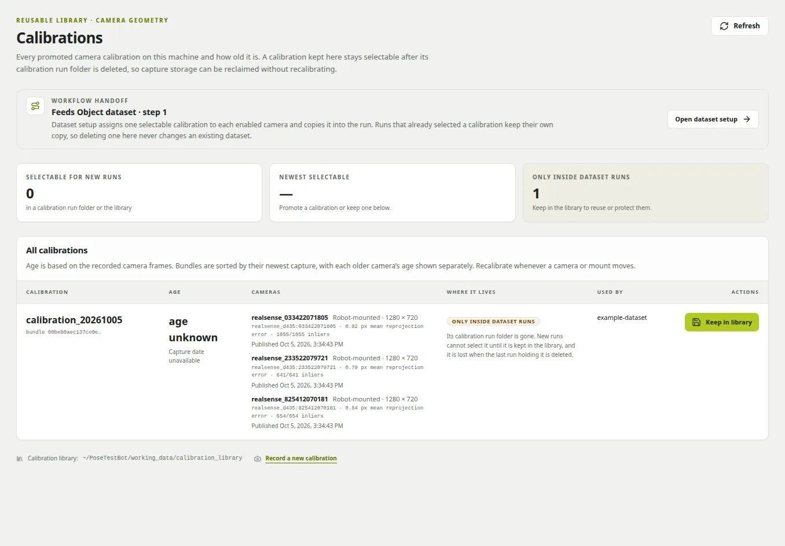
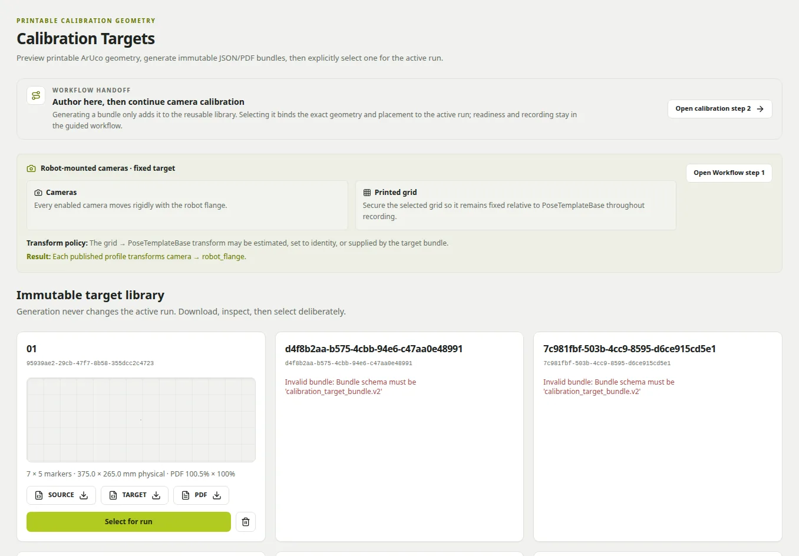

# Calibrate cameras

A calibration tells PoseTestBot each camera's lens model (*intrinsics*) and
exactly where the camera sits relative to the robot (*extrinsics*). Every
dataset needs a calibration that matches its cameras.

!!! tip "Do you need to calibrate?"

    Open **Prepare → Calibrations**. If a calibration exists for the cameras
    you want to use, with the same resolution and mounting, and nobody has
    touched the cameras since, **reuse it** and go straight to
    [Record a dataset](record-dataset.md).

    Recalibrate after cameras were moved, re-mounted, or swapped, or when the
    console warns that a calibration is old.

[{ loading=lazy }](../images/console/calibrations.webp)

## What you need

- The printed **ArUco calibration grid** whose layout matches a bundle on the
  **Calibration Targets** page.
- The robot calibration application launched and waiting on the KUKA
  controller (ask your supervisor).
- About 30–45 minutes, including 10–20 minutes of background computation.

## Step by step

Open **Workflow → Calibrate cameras**. If the active run already has a
recording, use **Start with a new run folder** first.

### 1. Configure the run and cameras

Tick **Use for this recording** for each camera you want to calibrate, then
check its resolution, frame rate, mounting (robot-mounted or static), and
orientation. Save the setup.

All cameras calibrated together must share one mounting type:

- **Robot-mounted cameras** look at a grid that lies fixed in the cell.
- **Static cameras** look at a grid attached to the robot flange.

### 2. Choose the printed grid and its mounting

[{ loading=lazy }](../images/console/calibration-targets.webp)

Click **Choose grid**. On **Calibration Targets**, find the bundle that matches
the *physical* board you are using (marker count and size) and click
**Select for run**. You return to the workflow automatically.

Generate a new bundle only if you print a new board. You can download the
PDF to print from the bundle card.

### 3. Check readiness

Click **Check readiness**. The check briefly opens each selected camera,
without moving the robot, and lists anything that blocks recording. Fix each
red item (the link next to it takes you to the right place) and check again.

### 4. Record calibration images

1. Mount the grid as selected in step 2, and clear the workcell.
2. Click **Review and start capture**.
3. Read the dialog (run folder, robot target, speed), tick the confirmation,
   and click **Start recording**.

The robot drives through its calibration poses while all cameras record.
Watch the cell the entire time. When it finishes, continue to step 5.

!!! warning

    Do not press **Exit idle program** on the Dashboard between calibration
    recordings. See [Lab safety](lab-safety.md).

### 5. Calculate, review, and publish

1. Under **Auto time alignment**, keep **Estimate robot-pose time offset
   (recommended)** unless your supervisor tells you otherwise.
2. Click **Analyze recording · estimate time offset**. The analysis usually
   takes 10–20 minutes, longer with more cameras, and continues in the
   background.
3. Review the results for each camera: reprojection error, lens model
   decision, time offset, and any quality warnings.
4. Click **Publish selected camera calibrations**.

Only published calibrations can be selected for datasets. Publishing also
stores a copy in the calibration library, so the calibration remains
available even if the calibration run folder is deleted later.

## Reading the results

| You see | What it means |
| --- | --- |
| Low reprojection error (around 1 px or less) | The grid detections fit the model well |
| **Quality warning** | The result is usable for research but missed a strict target. Read the note and decide with your supervisor |
| Time offset "0 ms kept with warning" | The delay between camera and robot could not be determined. It does **not** prove that there is no delay |
| Factory intrinsics selected | Normal. The camera's built-in lens model was good enough, so no new one was fitted |

## Common problems

- **Camera blocked in readiness**: another program (or a crashed recording)
  still holds the camera. Close camera previews on **Devices**, and check
  **Jobs** for a stuck job.
- **"Grid mounting does not match cameras"**: the selected grid's mounting
  (fixed vs. on the flange) does not fit the camera mounting from step 1.
  Select the grid again.
- **No passing solution**: too few grid detections. Check lighting and focus,
  make sure the board is flat, then record again in a new run folder.

??? info "Technical details"

    Each analysis is a separate *attempt* under
    `processed/calibration/<attempt_id>/`, with intrinsic comparison, time
    offset search, PnP/extrinsic candidates, ranking, and checks. Publishing
    writes `calibration_profiles.json` (`calibration.v2`) and a
    content-addressed copy in `working_data/calibration_library/`. Datasets
    store an immutable, hash-bound snapshot of the calibration they used.

    - [Detailed workflow reference](../OPERATOR_WORKFLOWS.md#outcome-1-calibrate-cameras)
    - [Calibration API and automatic time alignment](../reference/api/calibration.md)
    - [Calibration target generation](../POSEGRIDGEN_CALIBRATION_TARGETS.md)
    - [IIWA single-frame static calibration](../IIWA_SINGLE_FRAME_STATIC_CAMERA_CALIBRATION.md)
