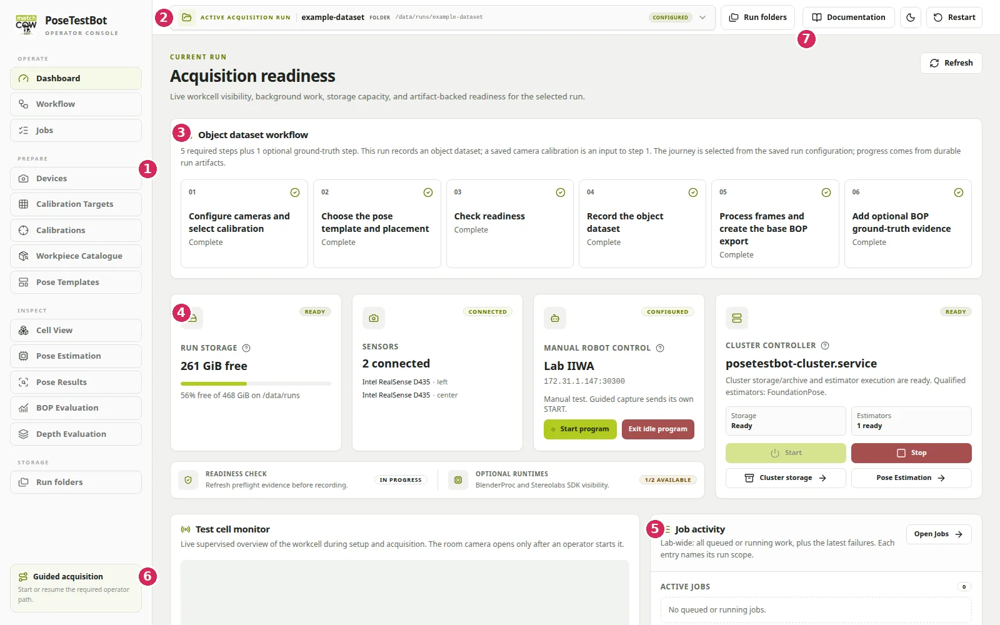
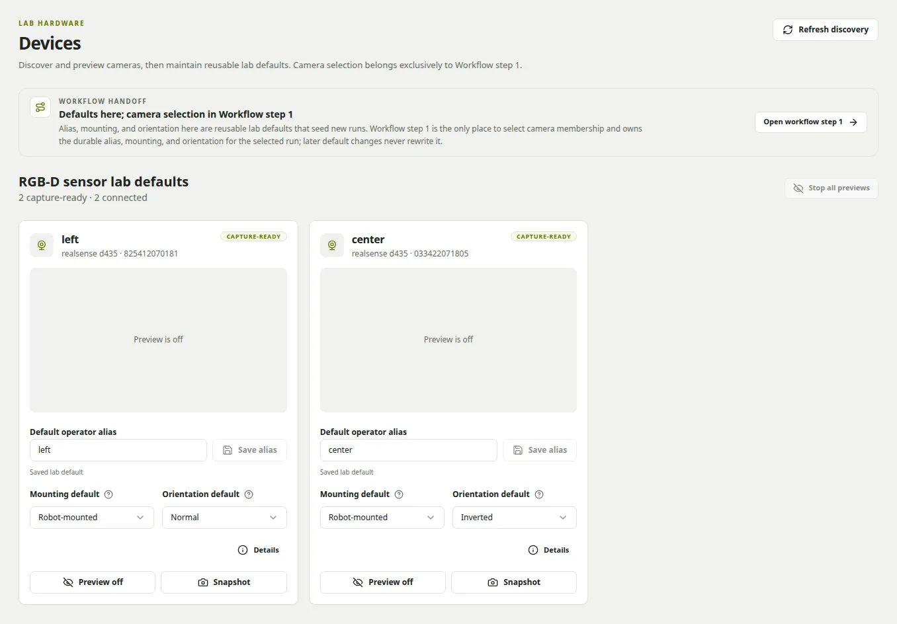
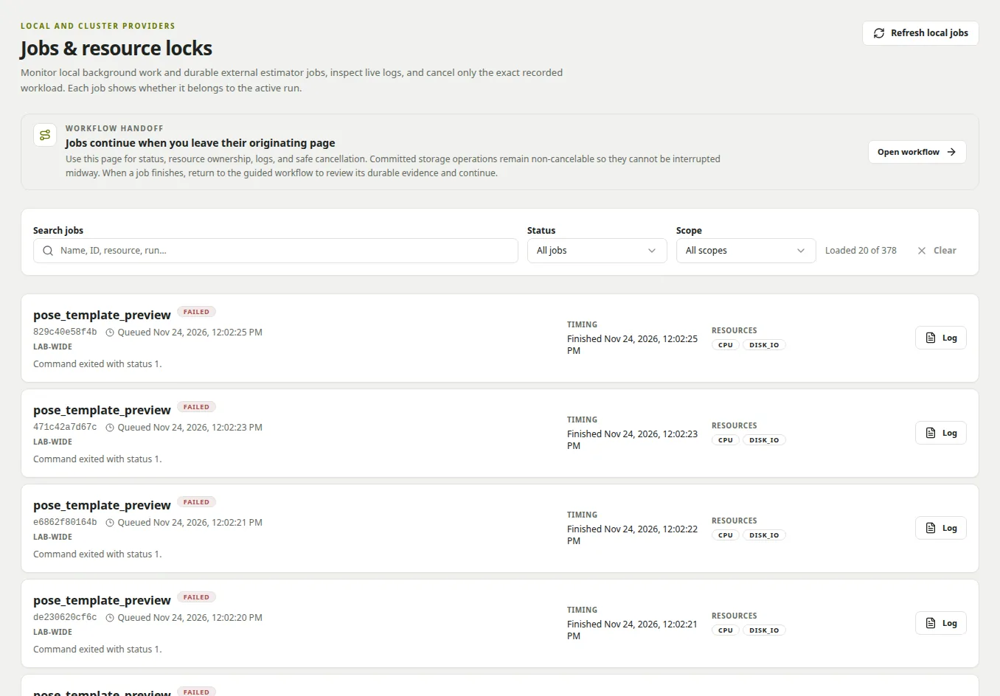

# Console tour

The operator console is designed for a desktop screen (1920 × 1080 is ideal).
It has a fixed layout: navigation on the left, the **active run** at the top,
and the current page in the middle.

[{ loading=lazy }](../images/console/console-tour.webp)

1. **Sidebar**: all pages, grouped by purpose (see below).
2. **Active acquisition run**: the run folder you are working on. Every
   workflow and inspection page uses this run. Click it to switch to another
   run; **Run folders** next to it creates new ones.
3. **Workflow progress** for the active run. Each tile is a step; a check mark
   means it is complete.
4. **Status cards**: free storage, connected cameras, the robot, and the GPU
   cluster.
5. **Job activity**: background work that is running or recently failed.
6. **Resume position**: jumps back to the step where you left off.
7. **Documentation** opens this site. The moon icon switches to dark mode.

## Pages in the sidebar

### Operate: the everyday pages

| Page | Use it to |
| --- | --- |
| **Dashboard** | Check that cameras, robot, storage, and cluster are OK |
| **Workflow** | Calibrate cameras or record a dataset, step by step |
| **Jobs** | Follow background work: progress, logs, cancel, errors |

### Prepare: reusable libraries

These pages manage things that are shared between runs. Changing them does
**not** change a run you already recorded.

| Page | Use it to |
| --- | --- |
| **Devices** | See connected cameras, preview them, and set default names and mounting |
| **Calibration Targets** | Choose (or generate) the printed calibration grid |
| **Calibrations** | See all published calibrations, how old they are, and which runs use them |
| **Workpiece Catalogue** | Upload and manage CAD models of your objects |
| **Pose Templates** | Arrange objects on a printable sheet that defines their true poses |

### Inspect: look at results

| Page | Use it to |
| --- | --- |
| **Cell View** | View cameras, robot path, and objects in 3D |
| **Pose Estimation** | Send the dataset to an estimator on the GPU cluster |
| **Pose Results** | Compare estimated and true poses frame by frame; export images/videos |
| **BOP Evaluation** | Compute official BOP scores and robot consistency |
| **Depth Evaluation** | Measure depth accuracy, compare surface finishes, make videos |

### Storage

| Page | Use it to |
| --- | --- |
| **Run folders** | Create, archive, move, or delete run folders |

## Things worth knowing

**The active run is remembered per browser.** Switching the run in the top
bar does not change any data; it only changes which run the pages show.

**Background jobs keep running.** When you start something long, the page
shows a link to **Jobs**. You can leave the page, close the browser, or come
back later. The job keeps running.

**Required choices start empty.** If a choice changes what you get, for
example which annotations are generated, nothing is preselected. The button
stays disabled and shows a *required* hint until you choose.

**Disabled buttons explain themselves.** Look right next to a disabled
button for the reason. The small **?** icons contain extra background
information, never required steps.

## Devices

[{ loading=lazy }](../images/console/devices.webp)

**Devices** shows every connected camera (currently mainly Intel RealSense
D435) with a live preview (off by
default) and a snapshot button. The *operator alias* (for example `left`,
`center`), mounting, and orientation set here are **defaults for new runs**.
Which cameras are used in a recording is chosen in the workflow, not here.

## Jobs

[{ loading=lazy }](../images/console/jobs.webp)

Every background task appears on **Jobs** with its status, timing, the
resources it holds (camera, robot, CPU, disk), and a **Log** button. Use the
search and the *Status* filter to find failed jobs quickly. A running job can
be canceled here.

??? info "Technical details"

    The console is a React single-page app served by the Flask backend
    (`posetestbot-web`, port 5000). It has no login, so only expose it on the
    lab network. Jobs run through a local job runner that locks hardware
    resources so that two jobs cannot use the same camera or the robot at once.
    See [System overview](../getting-started/overview.md) and
    [Architecture and boundaries](../concepts/architecture.md).
