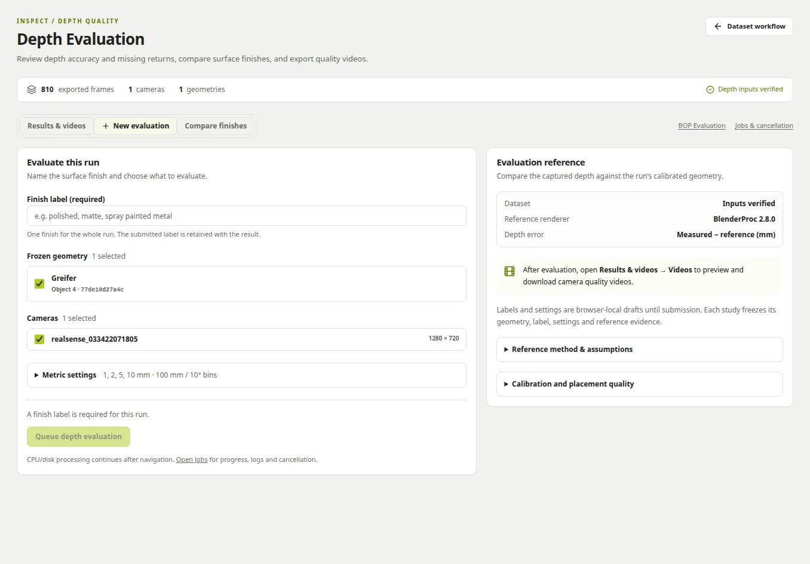

# Evaluate depth quality

**Inspect → Depth Evaluation** measures how accurately each camera measures
depth on your objects. It compares the recorded depth images with a perfect
*reference depth* rendered from the CAD models at their known poses.

Typical student questions it answers:

- How much depth error does each camera have, and how much depth is missing?
- Do shiny, matte, or spray-painted finishes change depth quality?
- How does error grow with distance or with a steep viewing angle?

**You need:** a dataset with **pose ground truth** (with or without masks).
No estimator result is needed.

[{ loading=lazy }](../images/console/depth-evaluation.webp)

## 1. Evaluate a run

1. Open **Inspect → Depth Evaluation** and go to **New evaluation**.
2. Enter a **finish label** that describes the surface of the objects in this
   run, for example `matte`, `polished`, or `spray painted metal`. It is
   required and cannot be changed later.
3. Select the objects (*frozen geometry*) and the cameras to evaluate.
4. Optionally open **Metric settings** (error thresholds, distance and angle
   bins).
5. Click **Queue depth evaluation**. Rendering the reference runs on the CPU
   and can take a while for long recordings.

## 2. Look at the results

Open **Results & videos**:

- **Overview**: completeness and error summaries per camera and object.
- **Frames**: the RGB image next to a depth, error, or missing-depth map.
- **Metrics**: exact numbers, including errors by distance and incidence
  angle.
- **Videos**: create an MP4 per camera from the result images.
- **Evidence**: what was evaluated and with which settings.

You can download a standalone **research bundle** (ZIP) with all metrics and
maps for your own analysis.

## 3. Compare finishes

Record the same objects with different finishes in separate runs and
evaluate each run. Then use **Compare finishes** with the active run as one
of the inputs. Only evaluations with the same object geometry and settings
can be compared. The comparison bins results by distance and viewing angle
so that differences in viewpoint do not distort the result.

## Common problems

- **A camera cannot be selected**: the reference renderer needs a rectified
  or distortion-free camera. Make sure the dataset was processed (step 5 of
  the dataset workflow).
- **"Queue depth evaluation" is disabled**: a finish label is required.
- **Video is disabled**: FFmpeg is not installed. The research bundle still
  works.

??? info "Technical details"

    References are rendered with BlenderProc 2.8.0 on the CPU. All known
    objects are rendered together as opaque surfaces with flat normals.
    Which pixels are evaluated never depends on the measured depth or masks.
    Results are published atomically under
    `processed/bop_evaluation/depth/`.

    - [Depth quality and finishes: definitions and interpretation](../concepts/depth-evaluation.md)
    - [Depth evaluation API](../reference/api/depth-evaluation.md)
