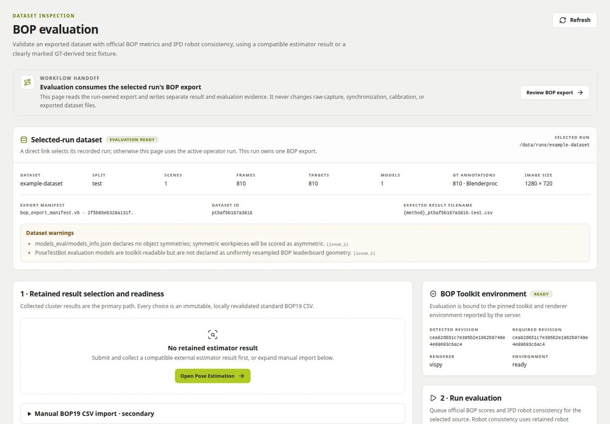

# Evaluate pose accuracy

**Inspect → BOP Evaluation** scores an estimator result against your dataset's
ground truth with the **official BOP Toolkit**, the same code used for the
public BOP benchmark. It also adds a **robot-consistency** score that needs no
ground truth.

**You need:** a dataset with **pose ground truth plus masks**, and a collected
estimator result (see [Run a pose estimator](pose-estimation.md)).

[{ loading=lazy }](../images/console/bop-evaluation.webp)

## Run an evaluation

1. Open **Inspect → BOP Evaluation**. The top card confirms which dataset is
   evaluated and lists any dataset warnings.
2. In **1 · Retained result selection and readiness**, choose the result.
3. In **2 · Run evaluation**, click **Queue BOP evaluation**. The job runs in
   the background; you can follow it on **Jobs**.
4. When it finishes, the report and the evaluation history for that result
   appear on the page.

You can also import a BOP19 CSV from another source under **Manual BOP19 CSV
import**, as long as it matches this dataset exactly.

## Read the scores

| Score | Meaning | Better |
| --- | --- | --- |
| **Average Recall** | Overall BOP score, the mean of the three below | Higher (0–1) |
| **AR VSD** | Recall for visible surface discrepancy: compares rendered depth of the visible parts | Higher |
| **AR MSSD** | Recall for maximum symmetry-aware surface distance, in 3D | Higher |
| **AR MSPD** | Recall for maximum symmetry-aware projection distance, in the image | Higher |
| **Average time / image** | Estimator run time reported in the result | Lower |
| **Robot consistency MVD / ADD** | How much the estimated object pose *moves* in the world when only the camera moves (mm) | Lower |

**Robot consistency** uses the fact that the objects do not move while the
robot moves the camera. A perfect estimator would report the same world pose
from every viewpoint. A low score shows repeatable estimates, but a constant
offset can still score zero, so always look at the BOP recall as well. It is
*unavailable* (not zero) when there are too few robot-moved viewpoints, for
example with static cameras.

!!! warning "Test-only simulation"

    The advanced section can create a fake result by slightly perturbing the
    ground truth. This only tests the evaluation pipeline. Never report it
    as estimator performance.

## Comparing results

Each collected result and each evaluation is kept permanently, so you can
evaluate several estimator runs (for example tracking vs. registration) and
compare their reports. A result that covers only some cameras is labelled
*sensor-scoped* and is not directly comparable with a full-dataset result.

??? info "Technical details"

    Evaluations live in
    `processed/bop_evaluation/evaluations/<evaluation_id>/`, with the frozen
    request, toolkit output, and `report.json`. Robot consistency follows the
    IPD definition (arithmetic pose mean, MVD/ADD in millimetres) and stores
    its hash-bound inputs alongside.

    - [Robot consistency metric](../concepts/robot-consistency.md)
    - [BOP and cluster API](../reference/api/bop-cluster.md)
    - [BOP Toolkit](https://github.com/thodan/bop_toolkit) (external)
