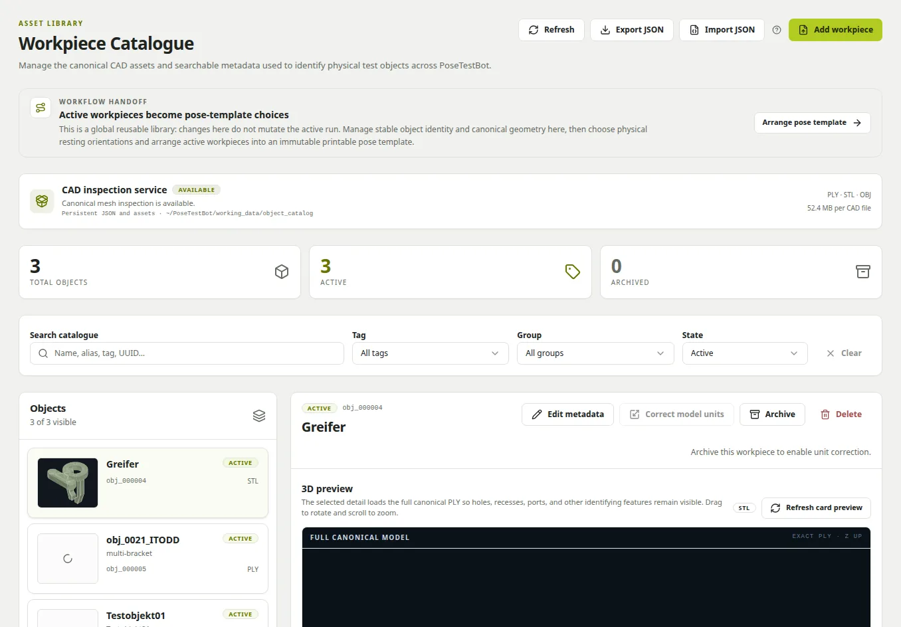
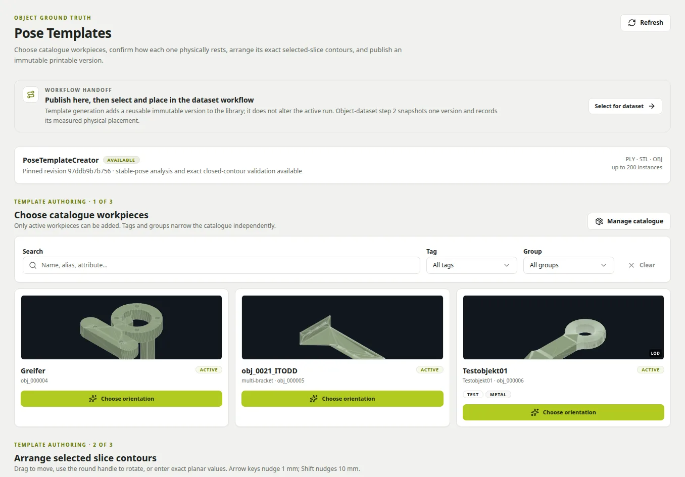

# Prepare objects and pose templates

PoseTestBot knows the true pose of every object because you place the objects
on a **printed pose template**: a sheet that shows the exact outline of each
object. Creating that template is a two-page process:

1. **Workpiece Catalogue**: store the CAD model of each object once.
2. **Pose Templates**: choose how each object rests and arrange the objects
   into a printable sheet.

Both are shared libraries. Once your objects and template exist, any number
of datasets can reuse them.

## 1. Add objects to the Workpiece Catalogue

[{ loading=lazy }](../images/console/workpieces.webp)

1. Click **Add workpiece** and upload a **PLY, STL, or OBJ** file (optionally
   with a PNG texture). Conversion runs as a short background job.
2. Give it a clear **name**. Alias, description, tags, and groups are
   optional, but they help others find the object.
3. Check the **3D preview** and the dimensions. If the object is 1000× too big
   or too small, the CAD file was in metres instead of millimetres: **Archive**
   the workpiece, then use **Correct model units**.

!!! tip

    Search the catalogue first. The object may already be there. Each object
    keeps a permanent BOP object ID, so reusing it keeps datasets comparable.

## 2. Create a pose template

[{ loading=lazy }](../images/console/pose-templates.webp)

1. **Choose catalogue workpieces**: pick the objects for your scene.
2. **Choose orientation**: for each object, choose the stable resting pose
   (which side lies on the table).
3. **Arrange selected slice contours**: drag and rotate the outlines on the
   sheet. Arrow keys nudge by 1 mm; hold Shift for 10 mm.
4. **Generate immutable version** and print the PDF at **100 % scale**. Check
   a known dimension on the printout with a ruler.

A published template never changes. To modify it, create a new version.

## 3. Use the template in a dataset

You link the template to a recording in step 2 of
[Record an object dataset](record-dataset.md). There you also enter where the
printed sheet lies in the workcell.

## Common problems

- **Upload fails**: the mesh may be broken or too large. Re-export it from
  your CAD tool as a binary STL or PLY.
- **Object cannot be deleted**: a published pose template uses it. Archive it
  instead.
- **Printed sheet is the wrong size**: printer scaling ("fit to page") was on.
  Print again at 100 %.

??? info "Technical details"

    The catalogue (`object_catalog.v1`) stores each workpiece below
    `working_data/object_catalog/objects/<uuid>/` with a stable UUID and BOP
    `obj_id`. Templates are immutable bundles in
    `working_data/pose_templates/<uuid>/`. A run stores its own snapshot
    (`pose_template_selection.json`, `object_instances.json`), so later
    library changes never affect it.

    - [Workpiece Catalogue reference](../WORKPIECE_CATALOGUE.md)
    - [Pose templates and object GT](../POSETEMPLATECREATOR_OBJECT_GT.md)
    - [Workpiece and template API](../reference/api/catalogs.md)
