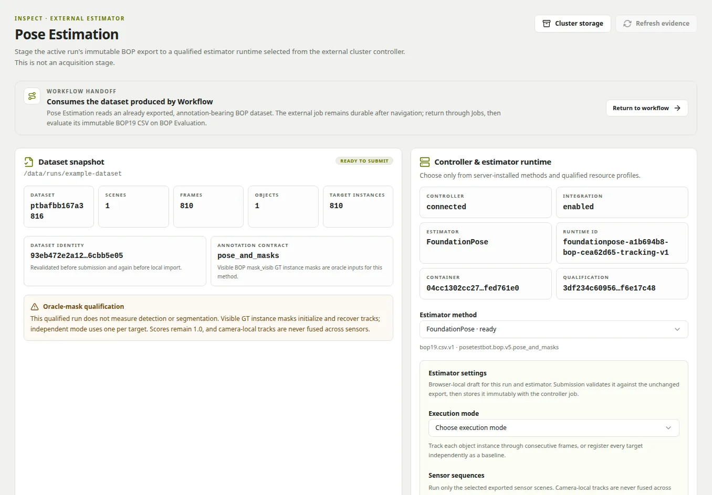
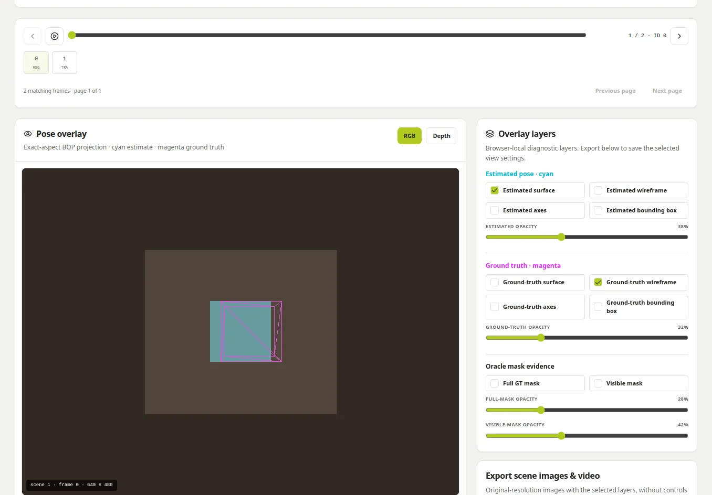

# Run a pose estimator

PoseTestBot itself does not contain a pose estimator. Instead, **Pose
Estimation** sends your exported dataset to the lab's GPU cluster, where a
companion service runs the estimator (currently **FoundationPose**) and
returns a standard BOP19 result file.

**You need:** a dataset with **pose ground truth plus masks** (step 6 of
[Record a dataset](record-dataset.md)), and a cluster controller that shows
*Ready* on the Dashboard.

## 1. Submit a job

[{ loading=lazy }](../images/console/pose-estimation.webp)

1. Open **Inspect → Pose Estimation**. The left card summarizes your
   dataset (scenes, frames, objects); the right card shows the cluster and
   estimator status.
2. Choose the **estimator method**, for example *FoundationPose*.
3. Choose the **execution mode**:
    - **Tracking**: each object is tracked through consecutive frames
      of each camera. This is the default.
    - **Independent registration**: every frame is estimated from scratch.
      Use it as a per-frame baseline.
4. Optionally deselect cameras (*sensor sequences*) to process only some of
   them.
5. Click **Submit**. The job runs on the cluster; you can leave the page.

!!! note "Ground-truth masks are used as input"

    FoundationPose is initialized with the visible ground-truth mask of each
    object. Report the results as *pose estimation from GT masks*, not as a
    full detection-plus-pose benchmark.

## 2. Collect the result

When the cluster job has succeeded, click **Collect result** on **Pose
Estimation** or on **Jobs**. PoseTestBot verifies the result against your
dataset and stores it permanently in the run folder. Each collected job
becomes a separate, unchangeable result that you can select later.

## 3. Look at the poses

[{ loading=lazy }](../images/console/pose-results.webp)

*Screenshot with synthetic test data.*

**Inspect → Pose Results** shows one frame at a time:

- Choose the result, the camera (scene), and the frame. Use the slider or
  the play button to step through frames.
- The default overlay shows the **estimate as a cyan surface** and the
  **ground truth as a magenta wireframe**. Under **Overlay layers** you can
  switch on axes, bounding boxes, and masks, and adjust their opacity.
- Switch between **RGB** and **Depth** backgrounds.
- Translation and rotation errors are shown when an estimate can be matched
  unambiguously to one ground-truth object.

### Export images or videos

Below the overlay controls:

- **Download images (.zip)**: lossless PNGs of every matching frame of the
  selected camera, with your current overlay settings.
- **Create & download MP4**: the same frames as a video. Set **Video FPS**
  (1–120) first.

Exports run as background jobs and download automatically when they are
ready. **All-sensor GT JSON** downloads the ground truth of all cameras in one
file (translations in millimetres) for your own analysis.

## Common problems

- **"No compatible retained pose result"**: no result has been collected for
  this run yet. Submit a job and click **Collect result**.
- **Submit is disabled**: read the reason next to the button. Usually the
  dataset has no masks, or the cluster is not ready.
- **MP4 is disabled**: FFmpeg is not installed on the lab PC. Use the ZIP
  export, or ask lab staff (see [Installation](../getting-started/installation.md#pose-results-mp4-exports)).

??? info "Technical details"

    Collected results are stored in
    `processed/bop_evaluation/results/<result_id>/` together with the CSV,
    its hash, and sanitized controller provenance. PoseTestBot only talks to
    the companion `posetestbot-cluster` controller over a local connection;
    estimator code, SSH credentials, and scheduler settings never enter this
    repository or the browser. Visualization exports are written to
    `processed/bop_evaluation/visualizations/`.

    - [Detailed workflow reference](../OPERATOR_WORKFLOWS.md#inspect-run-an-external-pose-estimator)
    - [BOP and cluster API](../reference/api/bop-cluster.md)
