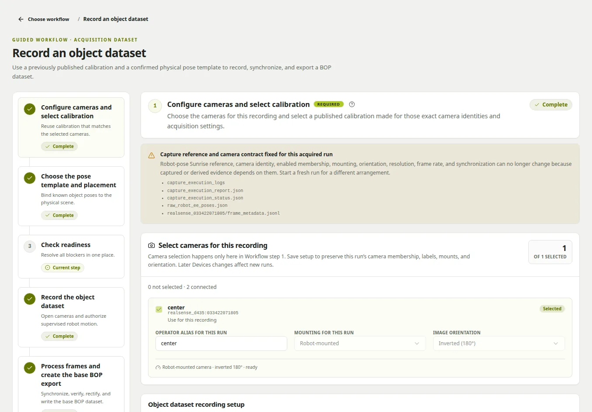
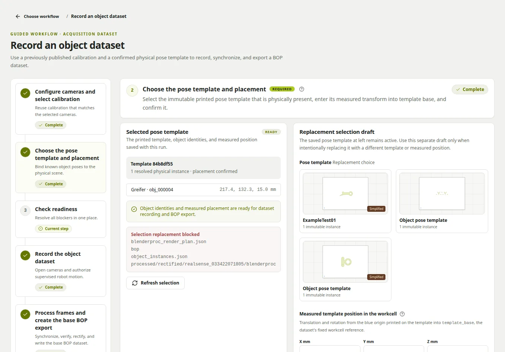
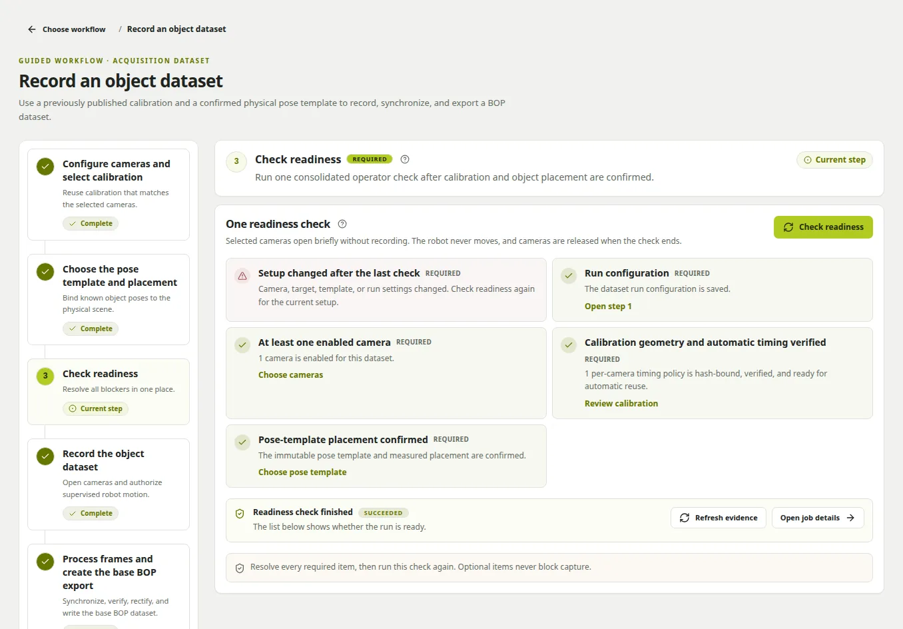
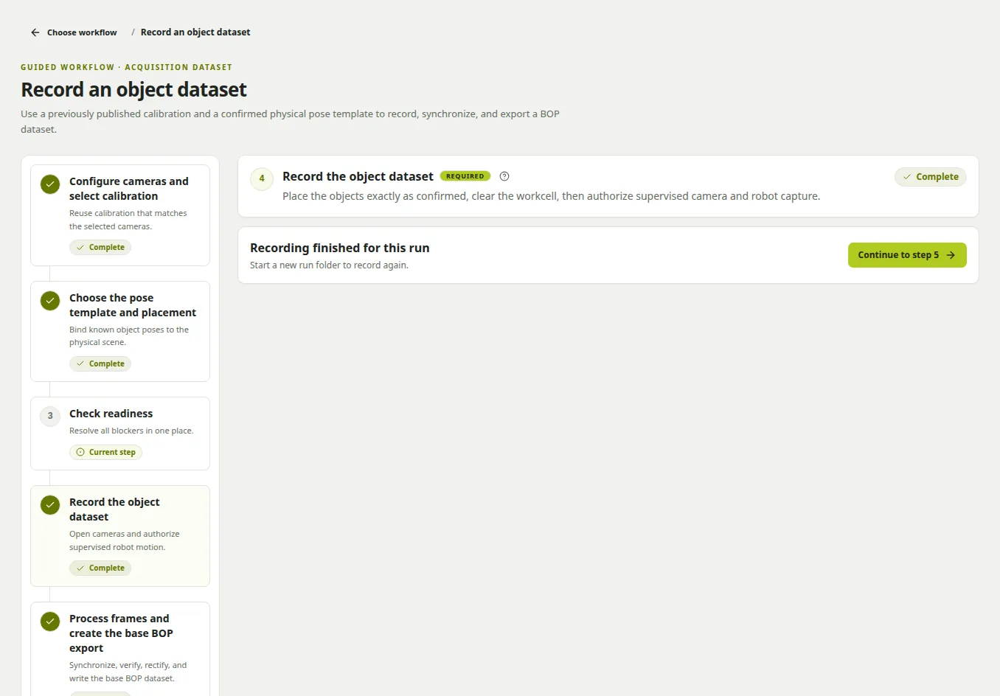
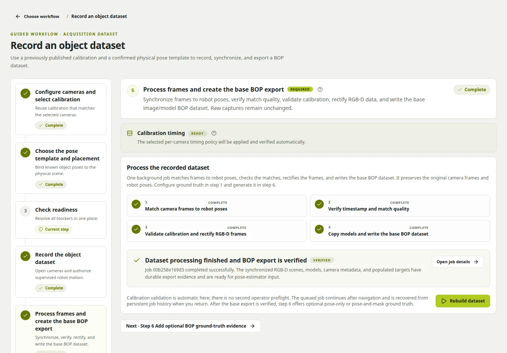
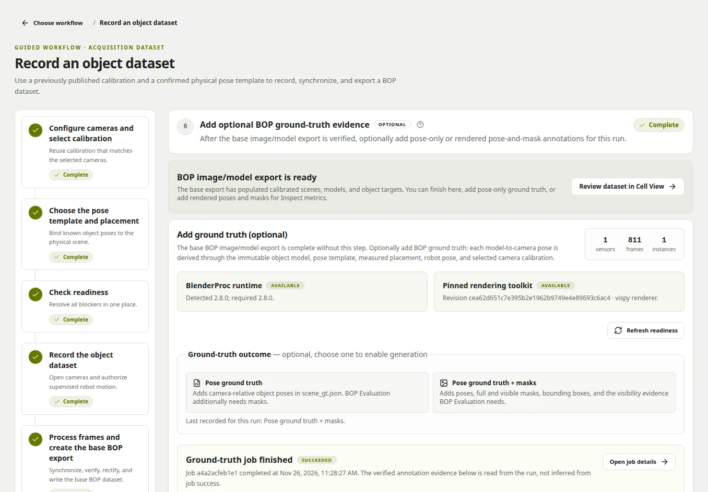
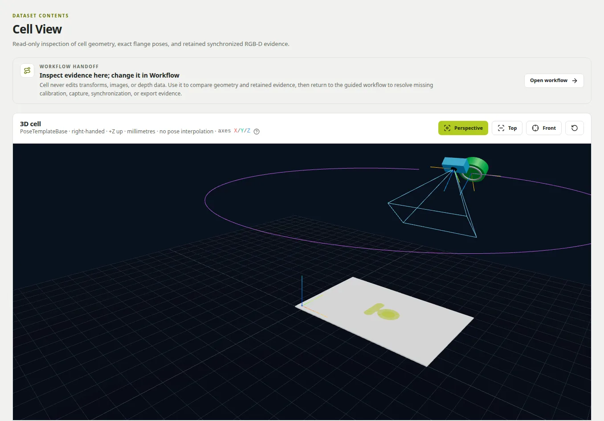

# Record an object dataset

This is the main workflow. At the end you have a BOP dataset with RGB and
depth images from every camera, the object models, the calibration, and
optionally ground-truth poses and masks.

**You need:** a published [calibration](calibrate-cameras.md) for your
cameras, a printed [pose template](objects-and-templates.md) with your
objects, and the robot capture application launched and waiting on the KUKA
controller.

Open **Workflow → Record an object dataset**. The step rail on the left shows
where you are; you can click any step to review it.

## 1. Configure cameras and select calibration

[{ loading=lazy }](../images/console/dataset-1-configure.webp)

1. Start from a **new run folder** (top bar → **Run folders**, or **Start with
   a new run folder** on the workflow page).
2. Tick **Use for this recording** for each camera. Check the alias,
   mounting, and image orientation for this run.
3. Select a **saved camera calibration**. Only calibrations that match the
   selected cameras exactly (identity, resolution, mounting) are offered,
   newest first.
4. Choose the **BOP annotation outcome**. Nothing is preselected:

    | Option | You get | Choose it when |
    | --- | --- | --- |
    | Base dataset only | Images, depth, models, calibration | You only need the raw dataset |
    | Pose ground truth | + `scene_gt.json` with object poses | You need poses, or want depth evaluation |
    | Pose ground truth plus masks | + object masks and visibility | You want to **run a pose estimator** or compute **BOP scores** |

5. Save the setup.

!!! note

    Once the recording has been made, these settings are locked. To change
    cameras or calibration, start a new run folder.

## 2. Choose the pose template and placement

[{ loading=lazy }](../images/console/dataset-2-template.webp)

1. Select the pose template that is physically printed and lying in the
   cell.
2. Fill in **Measured template position in the workcell**: translation
   (X, Y, Z in mm) and rotation of the printed sheet relative to the
   template base frame. Ask your supervisor how this is measured in your lab.
3. Confirm the placement.

Place each object exactly on its printed outline.

## 3. Check readiness

[{ loading=lazy }](../images/console/dataset-3-readiness.webp)

Click **Check readiness**. Every requirement must show a green check. Each
red item has a link to the place where you can fix it. If you change the
setup afterwards, run the check again.

## 4. Record the object dataset

1. Make sure the objects are on their outlines and the cell is clear.
2. Click **Review and start capture**, check the run folder and speed in the
   dialog, tick the confirmation, and click **Start recording**.
3. Supervise the robot until it finishes.

[{ loading=lazy }](../images/console/dataset-4-capture.webp)

The raw recording (RGB, depth, timestamps, robot poses) is saved unchanged.
Later processing never modifies or deletes it.

## 5. Process frames and create the base BOP export

[{ loading=lazy }](../images/console/dataset-5-process.webp)

Click **Process and export dataset**. One background job runs four stages:

1. **Match camera frames to robot poses** using their timestamps.
2. **Verify timestamp and match quality**.
3. **Validate calibration and rectify** the RGB-D frames.
4. **Copy models and write the base BOP dataset**.

This takes a few minutes, depending on the number of frames. When it shows
**verified**, the base dataset is complete.

## 6. Add optional BOP ground truth

[{ loading=lazy }](../images/console/dataset-6-ground-truth.webp)

If you chose pose ground truth (with or without masks) in step 1, click
**Generate pose GT** or **Generate pose + masks**. Masks are rendered for
every frame, so this can take a while. When it finishes, continue with
[pose estimation](pose-estimation.md) or
[evaluation](evaluate-poses.md).

To check that the objects line up with the images, open **Inspect → Cell View**
or click **Review dataset in Cell View**.

[{ loading=lazy }](../images/console/cell-view.webp)

## Common problems

| Problem | What to do |
| --- | --- |
| No calibration is offered in step 1 | No published calibration matches the selected cameras, resolution, or mounting. Check **Calibrations**, or [calibrate](calibrate-cameras.md) |
| Readiness: camera blocked | Turn off previews on **Devices**; look for a stuck job on **Jobs** |
| Readiness: "Setup changed after the last check" | Click **Check readiness** again |
| Processing failed | Open the job log on **Jobs**. The raw recording is safe; click **Retry processing** after fixing the cause |
| Objects in the overlay are offset | The template placement (step 2) or object positions were wrong. Record again in a new run folder |

??? info "Technical details"

    The run configuration (`run_config.v4`) uses `timestamp_aligned`
    synchronization: each camera records its own timestamps, which are
    matched to the robot pose stream afterwards without modifying raw data.
    Frames before and after the robot motion are kept as context and are not
    counted as synchronization failures. The export writes
    `bop/bop_export_manifest.json` (`bop_export_manifest.v5`). Ground truth
    adds `scene_gt.json`, and with masks also `scene_gt_info.json`, `mask/`,
    and `mask_visib/`.

    - [Detailed workflow reference](../OPERATOR_WORKFLOWS.md#outcome-2-record-an-object-dataset)
    - [Run configuration](../reference/run-config.md)
    - [Artifact index](../reference/artifacts.md)
    - [Capture and orchestration API](../reference/api/capture-pipeline.md)
