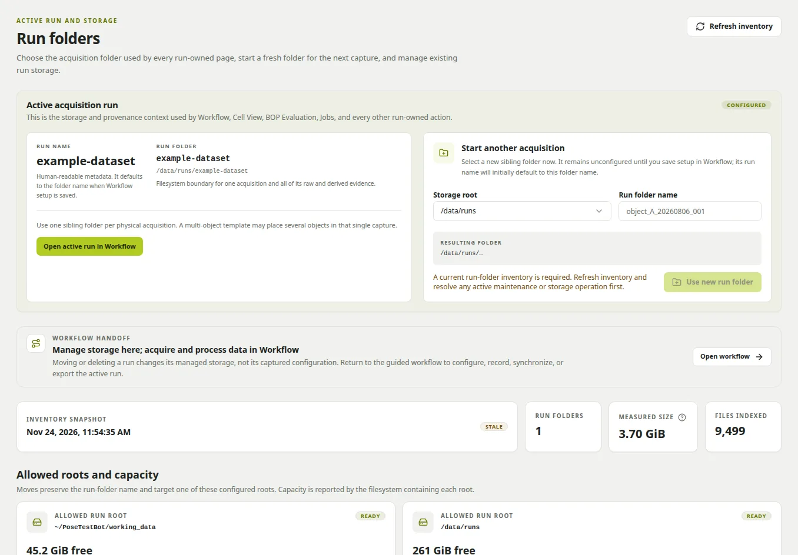

# Runs, jobs, and your data

## Run folders

Every calibration or dataset recording is a **run**, which is simply a folder
on disk. Everything about that recording lives in it: settings, raw images,
robot poses, processed data, the BOP export, and evaluations.

[{ loading=lazy }](../images/console/run-folders.webp)

On **Storage → Run folders** (or **Open run folders** in the top-bar
**Active acquisition run** menu) you can:

- **Start another acquisition**: choose a storage root and a folder name. The
  new folder becomes the active run.
- **Switch the active run** to look at an older recording.
- **Archive, move, or delete** runs that you no longer need.

Name folders so that others can understand them, for example
`object_A_matte_20261124`.

!!! warning "Deleting a calibration run"

    If you delete a run that published a calibration, the console asks
    whether to keep the calibration in the library. Keep it if anyone may
    still need it.

## Where your files are

Runs are stored under one of the approved storage roots, usually
`/mnt/working_data_ssd/` (fast SSD) or `working_data/` in the PoseTestBot
folder. The most important parts of a dataset run:

```text
my-dataset-run/
├── run_config.json            settings of this run
├── realsense_<serial>/        raw recording of one camera (never modified):
│   ├── rgb/  depth/             images
│   └── frame_metadata.jsonl     per-frame timestamps
├── raw_robot_ee_poses.json    raw robot poses
├── processed/                 synchronized and rectified frames, evaluations
│   └── bop_evaluation/          estimator results, evaluations, depth studies, exports
└── bop/                       ← the BOP dataset: usually what you need
    ├── models/                  object models + models_info.json
    ├── models_eval/             models used by the BOP Toolkit
    ├── test/000001/             one scene per camera: rgb/, depth/, scene_camera.json,
    │                            scene_gt.json, scene_gt_info.json, mask/, mask_visib/
    └── test_targets_bop19.json
```

Each camera becomes one BOP **scene**. The file
`bop/posetestbot_bop_frame_map.json` links BOP image IDs back to the
original frames.

To take the data to your own machine, copy the whole `bop/` folder. Copy the
full run folder if you also need the raw data. Downloads such as result CSVs,
pose videos, and depth research bundles are available directly in the
**Inspect** pages.

## Jobs

Anything that takes longer than a moment (readiness checks, recordings,
processing, ground truth, estimator collection, evaluations, exports) runs as
a background **job**.

- Every submission shows a link to its job.
- **Jobs** lists all work in the lab, newest first. Filter by status to find
  failures.
- **Log** shows the full output of a job, which is the first place to look
  when something fails.
- Running jobs can be **canceled**. Canceling a recording stops the cameras
  and local processes, but it never sends a stop to the robot.
- Jobs that need the same hardware wait for each other.

??? info "Technical details"

    Every artifact and its schema are listed in the
    [Artifact index](../reference/artifacts.md). How raw evidence, immutable
    inputs, and derived data relate is described in
    [Runs and artifact lineage](../concepts/runs-and-artifacts.md). The
    command-line equivalents of status checks and planning are in
    [CLI and scripts](../reference/cli.md).
