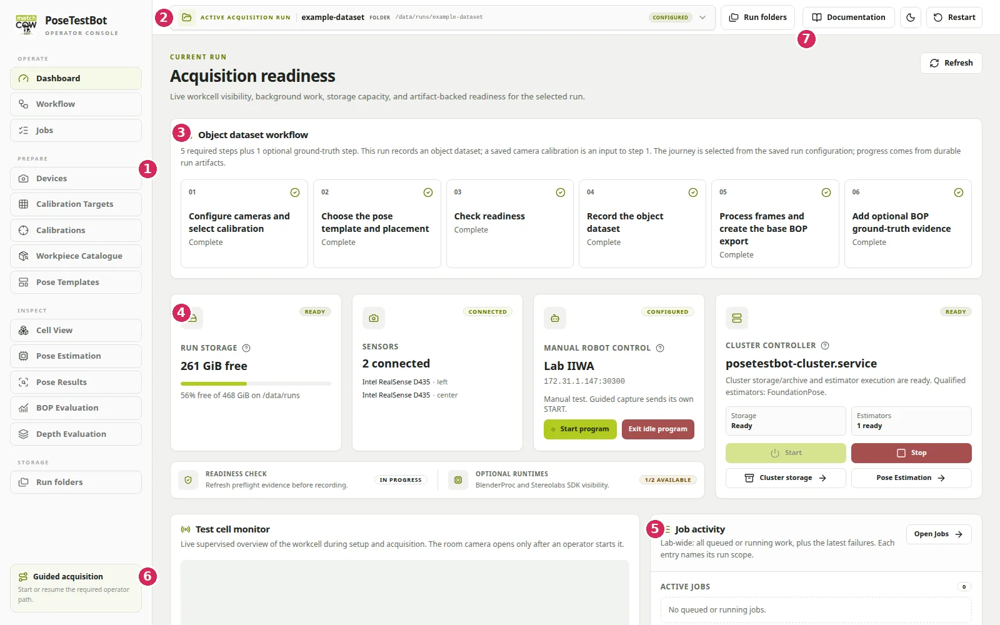
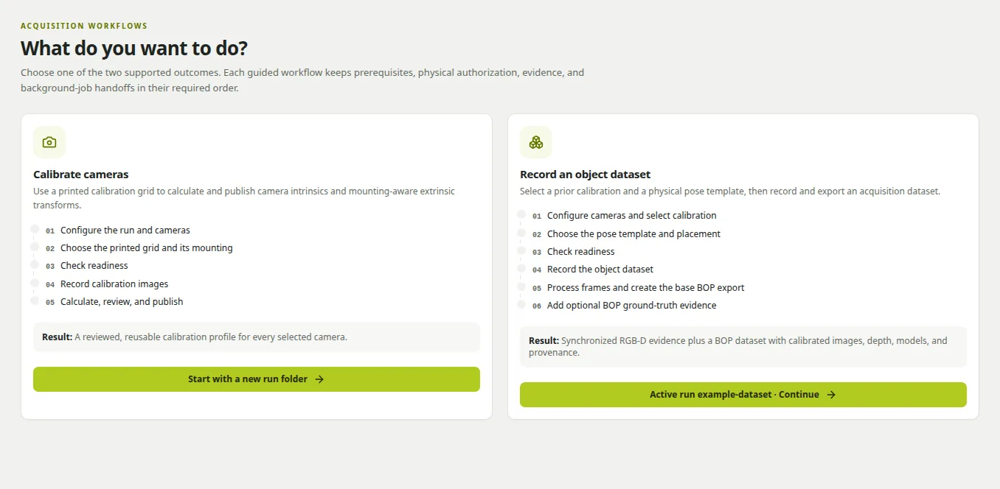

# Quickstart

This page walks through a complete session at a high level. Each step links
to a detailed guide. Plan about **half a day** for your first full dataset.
Most of that time is spent placing objects and waiting for background
processing.

!!! info "Before you start"

    - You have had a safety introduction to the robot cell from your
      supervisor. See [Lab safety](guide/lab-safety.md).
    - You know which **objects** you want to record and have their CAD models
      (PLY, STL, or OBJ, preferably in millimetres).
    - You are working on the lab PC, or your supervisor has given you the
      console address.

## 1. Open the console

On the lab PC, open <http://127.0.0.1:5000/> in a desktop browser (Chrome or
Firefox, full-screen window). You land on the **Dashboard**.

[{ loading=lazy }](images/console/console-tour.webp)

Check the status cards. **Sensors** should list the connected cameras, and
**Run storage** should show enough free space; a dataset takes a few GiB. The
[Console tour](guide/console-tour.md) explains every numbered area.

## 2. Pick what you want to do

Open **Workflow** in the left sidebar. The console offers exactly two guided
workflows:

[{ loading=lazy }](images/console/workflow-choose.webp)

| Workflow | When you need it | Result |
| --- | --- | --- |
| **Calibrate cameras** | Cameras were added, moved, re-mounted, or the last calibration is old | A reusable calibration for each camera |
| **Record an object dataset** | You want images of your objects with known poses | A BOP dataset, optionally with pose ground truth and masks |

Every recording lives in its own **run folder**. If the active run already
contains a recording, use **Start with a new run folder**. Never record twice
into the same folder.

## 3. Calibrate (only if needed)

Open **Prepare → Calibrations** to see the calibrations that already exist.
If a recent calibration covers the cameras you want to use, and nobody has
moved them, skip this step.

Otherwise follow [Calibrate cameras](guide/calibrate-cameras.md): choose
cameras, select the printed grid, check readiness, let the robot record the
grid, then analyze and **publish** the calibration.

## 4. Add your objects

1. **Workpiece Catalogue**: upload each CAD model once and check its size in
   the 3D preview.
2. **Pose Templates**: arrange the objects on a printable sheet. The printed
   sheet tells you exactly where each object goes, which is how PoseTestBot
   knows the true pose of every object.

Details: [Prepare objects and pose templates](guide/objects-and-templates.md).

## 5. Record the dataset

Follow the six steps of **Record an object dataset**:

1. Select cameras and the matching calibration, and choose the
   **BOP annotation outcome**. Choose *pose ground truth plus masks* if you
   want to run a pose estimator or compute BOP scores later.
2. Select your pose template and enter the measured position of the printed
   sheet.
3. **Check readiness** and fix anything shown in red.
4. Clear the workcell, confirm the authorization, and **Start recording**.
5. **Process and export dataset**. This runs in the background.
6. Generate the ground truth (pose, or pose + masks).

Details: [Record an object dataset](guide/record-dataset.md).

## 6. Estimate and evaluate

- **Inspect → Pose Estimation** sends your dataset to the GPU cluster
  (FoundationPose) and collects the result. See
  [Run a pose estimator](guide/pose-estimation.md).
- **Inspect → Pose Results** overlays estimated and true poses on every
  frame, and exports images or videos.
- **Inspect → BOP Evaluation** computes the official BOP scores. See
  [Evaluate pose accuracy](guide/evaluate-poses.md).
- **Inspect → Depth Evaluation** measures how well each camera sees surfaces,
  for example to compare matte and shiny finishes. See
  [Evaluate depth quality](guide/evaluate-depth.md).

## 7. Take your data with you

Your run folder contains the raw recording and the BOP dataset in `bop/`. See
[Runs, jobs, and your data](guide/runs-jobs-data.md) for where files live and
what to copy.

!!! tip "Long tasks keep running"

    Readiness checks, recordings, processing, ground truth, and evaluations run
    as background **jobs**. You can navigate away or close the tab; progress and
    logs stay available on the **Jobs** page.
